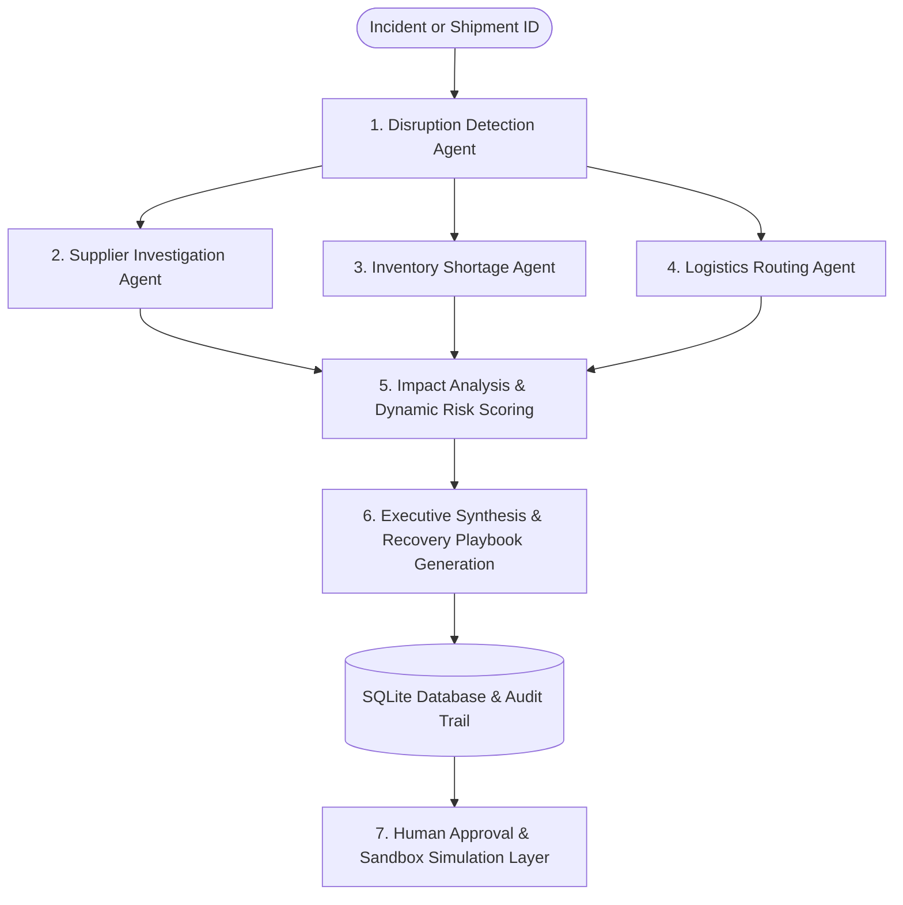

# Supply Chain Disruption Command Center

An enterprise-grade, responsive **Supply Chain Disruption Command Center** dashboard and REST API built with semantic HTML5, CSS3, Vanilla JavaScript, Python, Flask, **LangGraph Multi-Agent Orchestration**, **SQLite Persistent Storage with Human-in-the-Loop Governance**, **Dynamic Risk Scoring (0–100)**, and **Business Impact Analysis**.

The system coordinates specialized autonomous agents (Detection, Supplier Investigation, Inventory Shortage, Logistics Routing, and Business Impact Synthesis) to investigate disruptions, evaluate recovery alternatives, calculate business impact ROI, persist mitigation playbooks in SQLite, enforce human operator approval decisions, and maintain an immutable audit trail.

---

## 1. Technology Stack

- **Frontend:** Semantic HTML5, Modern CSS3 (Dark Navy enterprise theme, CSS Grid & Flexbox, responsive layouts, dynamic risk gauges), Vanilla JavaScript (ES6+ async/await, DOM management, zero external framework dependencies).
- **Backend:** Python 3.10+ / 3.12, Flask REST API.
- **Multi-Agent Orchestration:**
  - **LangGraph `StateGraph` Workflow:** Coordinates parallel investigation agents (Supplier, Inventory, Logistics) branching from Disruption Detection, fanning into Business Impact Analysis, and synthesizing an executive summary with verified timeline tracking.
  - **Deterministic Reasoner (Default Mode):** Operates reliably without external API keys or network latency, guaranteeing 100% test reproducibility and zero paid API requirements.
  - **Configurable Live LLM Mode:** Supports optional Google Gemini (`langchain-google-genai`), OpenAI (`langchain-openai`), or Groq via `.env`.
- **Database & Persistence:**
  - **SQLite Database:** Local persistent relational database located at `instance/supply_chain.db`.
  - **Flask-SQLAlchemy ORM:** Structured relational models for Disruptions, Analysis Runs, Recovery Plans, Recovery Options, Approval Decisions, and Audit Events.
- **Protocol:** RESTful JSON endpoints with CORS and strict `no-cache` headers for reliable dev iteration.

---

## 2. Multi-Agent System Architecture



### Specialized Agents:
1. **Disruption Detection Agent:** Evaluates shipment delays, inventory deficits, and active incident records to assign operational priority.
2. **Supplier Investigation Agent:** Investigates vendor delays and compares alternative suppliers, lead times, and capacity from the benchmark catalog.
3. **Inventory Agent:** Computes daily burn rates, buffer stock depletion curves, days to stockout, and target replenishment quantities.
4. **Logistics Agent:** Evaluates route rerouting, carrier alternatives, and expedited air freight turnaround times.
5. **Impact Analysis Agent:** Evaluates stockout revenue exposure, recovery costs, avoided loss, and net financial benefit ($ \text{Avoided Loss} - \text{Cost} $).
6. **Executive Synthesis Agent:** Generates explainable executive summaries with automatic deterministic fallback if LLM credentials are unconfigured or fail.
7. **Supervisor & Human Governance Layer:** Enforces operator sign-offs before sandbox simulation; prevents real-world financial or carrier commitments.

---

## 3. Project Structure

```text
supply-chain-command-center/
├── frontend/
│   ├── index.html              # Command center UI (Overview, Disruptions, Shipments, Inventory, Recovery, Audit)
│   ├── css/
│   │   └── style.css           # Enterprise theme, risk meter bars, factor cards, tables, badges, modals
│   └── js/
│       └── app.js              # Client state, REST client, live filters, modals, approval, simulation, audit & intel handlers
├── backend/
│   ├── agents/
│   │   ├── __init__.py         # Package initialization
│   │   ├── detector.py         # Agent 1: Disruption Detection Agent
│   │   ├── supplier.py         # Agent 2: Supplier Investigation Agent
│   │   ├── inventory.py        # Agent 3: Inventory Shortage Agent
│   │   ├── logistics.py        # Agent 4: Logistics Routing Agent
│   │   └── impact.py           # Agent 5: Impact Analysis Agent
│   ├── app.py                  # Flask server & REST endpoints
│   ├── config.py               # Environment & LLM provider abstraction (.env)
│   ├── data.py                 # Deterministic benchmark datasets & lookup functions
│   ├── models.py               # SQLite database models & immutable audit logger
│   ├── orchestrator.py         # Multi-Agent LangGraph StateGraph Orchestrator & Timeline
│   ├── risk_service.py         # Dynamic Risk Scoring, Business Impact & Recommendation Engine
│   ├── test_phase2.py          # Multi-agent test suite (11 tests)
│   ├── test_phase3.py          # Persistence & human approval test suite (9 tests)
│   ├── test_phase4.py          # Audit trail, filtering & status update test suite (5 tests)
│   ├── test_phase5.py          # Risk scoring, option comparison & intel test suite (9 tests)
│   ├── test_orchestration_verification.py # Orchestrator DAG & topology test suite (6 tests)
│   └── verify_demo_flow.py     # End-to-end recovery workflow verification script
├── instance/
│   └── supply_chain.db         # Persisted SQLite database file
├── .env.example                # Template for LLM provider API keys
├── requirements.txt            # Python dependencies (Flask, Flask-SQLAlchemy, LangGraph, etc.)
└── README.md                   # Project documentation & run instructions
```

---

## 4. Installation & Startup Instructions

### Step 1: Open Terminal in Project Root
```powershell
cd "c:\projects\SB projects\Supply Chain"
```

### Step 2: (Optional) Activate Virtual Environment
```powershell
python -m venv venv
.\venv\Scripts\Activate.ps1
```

### Step 3: Install Dependencies
```powershell
pip install -r requirements.txt
```

### Step 4: Start the Flask Backend Server
```powershell
python backend/app.py
```

The Flask server will start at:
👉 **`http://127.0.0.1:5000`**

### Step 5: Open the Command Center Dashboard
Open your browser and navigate to:
👉 **`http://127.0.0.1:5000`** (or open [`frontend/index.html`](frontend/index.html))

---

## 5. API Health-Check Verification

You can verify the backend status and persistence engine using PowerShell or `curl`:

```powershell
Invoke-RestMethod -Uri "http://127.0.0.1:5000/api/health"
```

**Expected Response:**
```json
{
  "database": "sqlite",
  "persistence": true,
  "phase": 5,
  "service": "supply-chain-command-center",
  "status": "ok"
}
```

---

## 6. Demonstration Sequence (Step-by-Step Walkthrough)

Follow this realistic demonstration sequence using the pre-seeded benchmark data:

### Step 1: Review Priority Disruption Prioritization
1. On the **Overview** dashboard, navigate to the **Priority Disruptions** section.
2. Notice that the disruptions are automatically sorted in **descending order of Risk Score**:
   - **`DIS-2026-001` (Enterprise Laptops / Shipment `SH-101`)**: **Risk: 61.2 / 100 — Critical Priority** surfaces first.
   - **`DIS-2026-002` (Industrial Batteries / Shipment `SH-103`)**: **Risk: 42.9 / 100 — Medium Priority** appears second.
   - **`DIS-2026-003` (Maritime Storm Reroute / Shipment `SH-103`)**: **Risk: 42.9 / 100 — Medium Priority** appears third.
3. Observe the visual distinction: `DIS-2026-001` has a red indicator bar and a top risk driver note: *Inventory Shortage Severity: 46 units below reorder threshold (14/60)*.

### Step 2: Inspect Disruption Risk Intelligence & Contributing Factors
1. Click **Investigate →** on `DIS-2026-001`.
2. The **Disruption Investigation Modal** opens displaying:
   - **Prominent Dynamic Risk Score:** `61.2 / 100` with visual progress meter across risk tiers.
   - **Prioritization Rationale:** Explains that warehouse buffer is critically depleted with only `1.8 days` of stock remaining and `$12,240.00` in enterprise customer revenue exposed.
   - **Top Contributing Factors Breakdown:** Shows points contributions vs. max points:
     - *Inventory Shortage Severity*: `+19.2/25 pts` (46 units below reorder threshold)
     - *Imminent Stockout Threat*: `+15.0/20 pts` (1.8 days of stock remaining)
     - *Shipment Criticality Tier*: `+15.0/15 pts` (Classified as Critical priority)
   - **Phase 5 Intelligence Notice:** Explains the 6-factor composite formula.

### Step 3: Run Multi-Agent Investigation
1. In the modal, click **⚡ Run Multi-Agent Analysis**.
2. The system executes the compiled LangGraph workflow across parallel agents:
   - **Step 1:** Disruption Detection Agent confirms Critical severity.
   - **Step 2:** Supplier Investigation Agent evaluates Apex Electronics (+3d delay) and secondary suppliers.
   - **Step 3:** Inventory Shortage Agent evaluates Hyderabad DC stockout timeline.
   - **Step 4:** Logistics Routing Agent evaluates BlueDart Aero Priority and expedited routes.
   - **Step 5:** Impact Analysis Agent projects financial exposure and calculates net benefits.
   - **Step 6:** Recovery Planning Agent synthesizes recommendations and persists playbooks to SQLite.
3. The modal updates with executive synthesis, parallel agent findings, and saved mitigation playbooks.

### Step 4: Review Multi-Agent Recommendation Intelligence
1. Click **View in Recovery Center →** (or navigate to the **Recovery Playbooks** tab).
2. Inspect the **Multi-Agent Recommendation Intelligence & Decision Rationale** panel:
   - **Time Until Stockout:** `1.8 Days` (Urgent)
   - **Revenue at Risk Exposure:** `$12,240.00`
   - **Expected Net Benefit:** `+$10,390.00`
   - **Resolution Velocity:** `1 Day(s)`
   - **Selection Rationale:** Explains why `OPT-1` (Expedited Air Freight via BlueDart) ranks #1 over `OPT-2` (Emergency PO) and `OPT-3` (Passive Monitoring).

### Step 5: Enforce Human-in-the-Loop Governance
1. In the Recovery Playbooks table, locate `OPT-2` (Emergency Secondary PO).
2. Click **✕ Reject**. Confirm the governance decision and enter a note: `"Procurement premium exceeds contingency reserve margin"`.
3. Notice that `OPT-2` transitions immediately to **Rejected**.
4. Locate `OPT-1` (Expedited Air Freight).
5. Attempting to simulate an unapproved option is blocked. Click **✓ Approve**.
6. Confirm the governance sign-off and enter a note: `"Authorized by director for urgent customer fulfillment"`.
7. Notice that `OPT-1` transitions to **Approved** and the overall plan status updates to **Approved**.

### Step 6: Execute Safe Sandbox Action Simulation
1. On approved option `OPT-1`, click **⚡ Simulate Execution**.
2. Confirm the simulation prompt.
3. The option transitions to **✓ Simulated**.
4. The system displays a confirmation notice:
   *"Action simulated safely in sandbox. Zero live external financial or carrier commitments were placed."*

### Step 7: Inspect the Persistent Audit Trail
1. Navigate to the **Audit Trail** tab in the sidebar.
2. Notice the immutable log records every action with timestamp, actor, and status transition:
   - `DISRUPTION_ANALYSIS_CREATED` (AI Agent / LangGraph Pipeline)
   - `DISRUPTION_ANALYSIS_COMPLETED` (AI Agent)
   - `RECOVERY_PLAN_CREATED` (AI Agent / Impact Agent)
   - `OPTION_REJECTED` (Human Operator / Supply Chain Director)
   - `OPTION_APPROVED` (Human Operator / Supply Chain Director)
   - `ACTION_SIMULATION_EXECUTED` (System / Simulation Sandbox)
3. Click **Inspect** on any event to view the full structured JSON payload.

---

## 7. Automated Testing Reference

Run the complete backend test suite across all modules:

```powershell
python -m unittest discover backend -p "test_*.py"
```

**Test Suite Coverage (40 Tests Total):**
- `backend/test_phase2.py`: Multi-agent detector, supplier, inventory, logistics, impact agents, and API endpoints (11 tests).
- `backend/test_phase3.py`: SQLite persistence, recovery plan creation, human approval decisions, simulation gating, and audit logging (9 tests).
- `backend/test_phase4.py`: Audit trail filtering, search, pagination, plan lifecycle status transitions, and single event detail retrieval (5 tests).
- `backend/test_phase5.py`: Dynamic 0–100 risk scoring, sensitivity tests, business impact ROI, explainable recommendations, descending risk sorting, and contributing factors payload (9 tests).
- `backend/test_orchestration_verification.py`: LangGraph topology, actual shipment data propagation, calculation consistency, deterministic fallback, database persistence, and human approval gating (6 tests).

---

## 8. API Endpoints Reference

| Method | Endpoint | Description | Sample Query / Payload |
| :--- | :--- | :--- | :--- |
| `GET` | `/` | Serves the HTML5 Command Center UI | `http://127.0.0.1:5000/` |
| `GET` | `/api/health` | Backend operational status & persistence info | `http://127.0.0.1:5000/api/health` |
| `GET` | `/api/dashboard` | Aggregated metrics, shipments, disruptions, inventory | `http://127.0.0.1:5000/api/dashboard` |
| `GET` | `/api/shipments` | All shipment records or filtered by status | `http://127.0.0.1:5000/api/shipments?status=Delayed` |
| `GET` | `/api/disruptions`| Priority disruption incidents sorted by risk score | `http://127.0.0.1:5000/api/disruptions` |
| `GET` | `/api/inventory` | Warehouse SKU inventory buffer levels | `http://127.0.0.1:5000/api/inventory` |
| `POST`| `/api/analyze-disruption` | Multi-Agent LangGraph Pipeline & SQLite persistence | `{"shipment_id": "SH-101"}` |
| `GET` | `/api/recovery-plans` | Retrieve all persisted recovery plans | `http://127.0.0.1:5000/api/recovery-plans` |
| `GET` | `/api/recovery-plans/<plan_id>` | Retrieve specific plan and options | `http://127.0.0.1:5000/api/recovery-plans/PLAN-SH-101` |
| `POST`| `/api/recovery-plans/<plan_id>/status` | Update plan lifecycle status with audit event | `{"status": "Pending Approval", "reason": "Awaiting director review", "actor": "Logistics Lead"}` |
| `POST`| `/api/recovery-options/<id>/decision` | Human Approval / Rejection decision | `{"decision": "Approved", "reason": "Expedited air-freight approved"}` |
| `POST`| `/api/recovery-options/<id>/simulate` | Safe sandbox simulation of approved option | *No body required* |
| `GET` | `/api/audit-events` | Filtered, searchable, paginated audit log | `http://127.0.0.1:5000/api/audit-events?event_type=OPTION_APPROVED&limit=10&page=1` |
| `GET` | `/api/audit-events/<event_id>` | Detailed inspection of single audit record | `http://127.0.0.1:5000/api/audit-events/1` |

---

## 9. Troubleshooting Guide

| Issue | Root Cause | Solution |
| :--- | :--- | :--- |
| **Port 5000 already in use** | A previous Flask server instance is still running in the background. | Stop the process in PowerShell: `Get-Process python \| Where-Object { $_.MainWindowTitle -eq "" } \| Stop-Process -Force` or use another port: `python backend/app.py --port 5001`. |
| **Windows `python.exe` Access Denied** | Windows App Execution Aliases can restrict access when sandboxed. | Run directly using your installed Python binary or virtual environment: `.\venv\Scripts\python.exe backend/app.py`. |
| **Dashboard stuck on "Connecting..."** | Flask backend server is not running or unreachable at `127.0.0.1:5000`. | Run `python backend/app.py` in your terminal and verify `http://127.0.0.1:5000/api/health` returns `status: "ok"`. |
| **Database locked error** | Concurrent write during manual file inspection. | SQLite handles multi-read/single-write safely; ensure no external SQLite GUI has an open uncommitted transaction. |

---

## 10. Scope Boundaries & Simulation Disclosure

- **Deterministic Benchmark Consistency:** Calculations for inventory burn rates, lead times, and freight tariffs use verified benchmark models to guarantee 100% test reliability without requiring paid API keys.
- **Simulation Sandbox Protection:** All action simulations (`POST /api/recovery-options/<id>/simulate`), emergency purchase orders, and carrier re-routings execute inside a safe simulation sandbox. **Zero binding external financial transactions or live carrier bookings are placed.**
